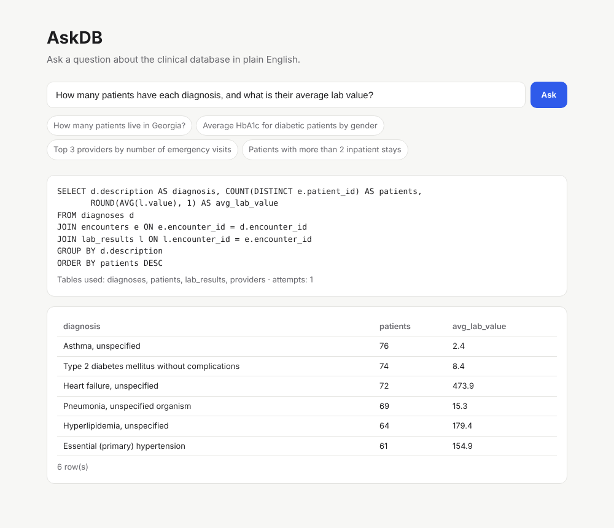

# AskDB — Natural Language to SQL

Ask a database a question in plain English and get back the SQL and the results. AskDB uses retrieval-augmented generation: it finds only the relevant tables and similar solved examples in a FAISS vector index, then asks Gemini to write a single read-only SQLite query.




## Features

- **RAG over the schema**: table descriptions and example question/SQL pairs are embedded and indexed with FAISS, so prompts stay small even for large schemas
- **Few-shot grounding**: the most similar solved examples go into the prompt
- **Self-correction**: if SQLite rejects the query, the error goes back to the model for one fix
- **Safe by design**: generated SQL must be a single `SELECT`/`WITH` statement, and it runs on a read-only connection that can't write even if validation were bypassed
- **Synthetic clinical dataset**: patients, providers, encounters, ICD-10 diagnoses, medications and lab results, with no real patient data
- **Web UI, REST API and command line**

## How it works

```
Question ─▶ Embed ─▶ FAISS search ─▶ top tables + similar examples
                                          │
                                          ▼
                              Gemini prompt ─▶ SQL
                                          │
                     validate (SELECT only) ─▶ run on read-only DB
                                          │
                       SQL error? ─▶ feed error back, retry once
                                          ▼
                                   columns + rows
```

The retriever, generator and database layers are separate modules. The embedder and the LLM are passed in as functions, so the whole pipeline can be tested offline with a hashing embedder and a stand-in model.

## Run it

```bash
git clone https://github.com/ramya036/askdb.git
cd askdb
python -m venv .venv && source .venv/bin/activate   # Windows: .venv\Scripts\activate
pip install -r requirements.txt
cp .env.example .env    # add your GEMINI_API_KEY (free at https://aistudio.google.com/apikey)
uvicorn askdb.app:app --reload
```

Open http://localhost:8000 and try *"Which medications are prescribed most for heart failure?"* The sample database is created on first run at `data/clinical.db`.

**Docker**

```bash
docker build -t askdb .
docker run -p 8000:8000 -e GEMINI_API_KEY=your_key askdb
```

**Command line**

```bash
python -m askdb.cli "Average HbA1c for diabetic patients by gender"
```

**API**: `POST /api/ask` with `{ "question": "How many patients live in each state?" }` returns the SQL, the number of attempts, the result rows and the tables and examples that were retrieved. `GET /api/schema` and `GET /api/health` are also available, with interactive docs at `/docs`.

**Configuration**

| Variable | Default | Description |
|---|---|---|
| `GEMINI_API_KEY` | none | Required for SQL generation |
| `ASKDB_EMBEDDER` | `gemini` | `gemini` for Gemini embeddings, `hashing` for an offline embedder |
| `ASKDB_DB_PATH` | `data/clinical.db` | Point at your own SQLite database |

To use your own database, set `ASKDB_DB_PATH`, add table notes in `app.py` and replace `data/examples.json` with examples from your domain.

## Tests

```bash
pip install -r requirements-dev.txt
pytest
```

14 tests cover the sample database, SQL safety checks (writes, multiple statements, keywords inside strings), the read-only connection, retrieval quality, every few-shot example executing, retry after a SQL error, and refusing unsafe model output. They use an offline embedder and a stand-in model, so they need no network or API key. GitHub Actions runs them on every push.

## Project structure

| File | Description |
|---|---|
| `askdb/app.py` | FastAPI app and pipeline wiring |
| `askdb/retriever.py` | Embeddings and FAISS index over schema and examples |
| `askdb/generator.py` | Prompt building, Gemini call, retry on SQL errors |
| `askdb/db.py` | Synthetic clinical database, SQL validation, read-only execution |
| `askdb/cli.py` | Command-line tool |
| `askdb/data/examples.json` | Few-shot question/SQL pairs |
| `askdb/static/index.html` | Web UI |
| `tests/` | pytest suite |
| `docs/app.png` | Screenshot |
